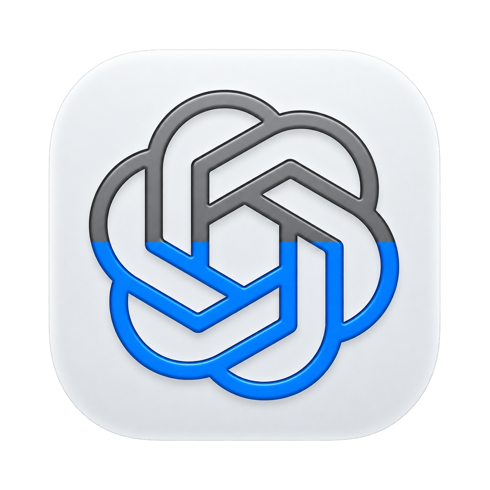
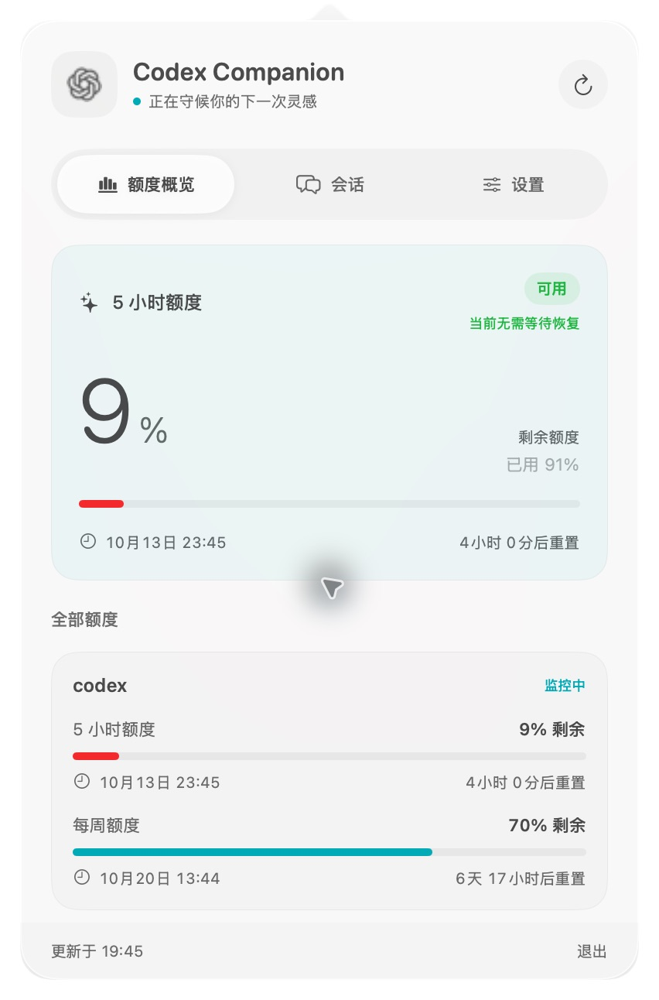
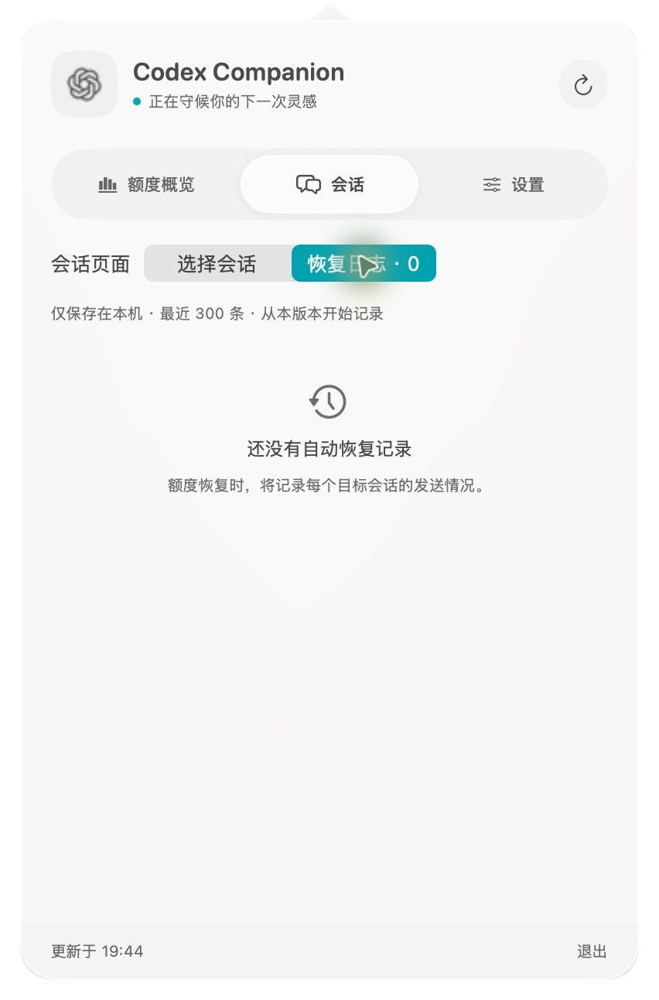

  
  <h1>Codex Limit Companion</h1>
  
<strong>少一点等待，多一点继续。</strong>

  
一个安静待在 Mac 菜单栏的 Codex 额度助手。 看清剩余额度，在额度恢复后，让选中的任务接着做。

  

    
    
    
    
  

  
<a href="https://createsun.github.io/codex-limit-companion/">产品主页</a> · <a href="https://github.com/CreateSun/codex-limit-companion/releases/latest">下载</a> · <a href="#开始使用">使用指南</a> · <a href="https://github.com/CreateSun/codex-limit-companion/issues">反馈问题</a>

---

## 让任务在合适的时候继续

不必反复打开 Codex 查看额度，也不必记住下一次重置时间。Codex Limit Companion 每 60 秒检查一次额度；当它观察到额度从耗尽恢复为可用时，向你选中的会话发送继续任务的消息。

- **抬眼就能看见** — 菜单栏图标的填充高度表示剩余额度，可选显示数字百分比。
- **短周期与每周额度** — 在同一面板查看剩余比例、重置时间、倒计时和预计恢复提示。
- **继续你选中的任务** — 搜索、筛选、多选最近会话；定向发送无需切换前台窗口。
- **每次触发都有记录** — 查看目标会话、触发时间、消息原文和发送结果，本机保留最近 300 条。
- **原生、轻巧** — SwiftUI 面板，macOS 26 使用 Liquid Glass；会话列表按需加载并缓存。
- **由你决定如何继续** — 配置消息、通知、自动发送及可选前台粘贴。

## 看看它的样子

  
  

应用实拍。左：额度概览；右：恢复日志的空状态。截图中的额度仅代表拍摄时的数据。

## 下载与安装

| 安装包 | 适用环境 |
| --- | --- |
| [下载 DMG 安装包](https://github.com/CreateSun/codex-limit-companion/releases/download/v0.0.3/CodexLimitCompanion-0.0.3-macos-arm64.dmg) | macOS 14+ · Apple Silicon |
| [下载 ZIP 压缩包](https://github.com/CreateSun/codex-limit-companion/releases/download/v0.0.3/CodexLimitCompanion-0.0.3-macos-arm64.zip) | 相同版本，解压后安装 |
| [所有版本与更新记录](https://github.com/CreateSun/codex-limit-companion/releases) | 查看历史版本和 SHA-256 校验文件 |

打开 DMG，将 **CodexLimitCompanion.app** 拖入 **Applications**，然后从“应用程序”启动。升级时先退出旧版，只保留一份应用。

> 当前安装包使用临时签名，尚未经过 Apple 公证。如果 macOS 阻止打开，请在「系统设置 → 隐私与安全性」中检查，或选择[从源码构建](DEVELOPING.md)。Intel Mac 目前需要自行编译。

## 开始使用

1. **准备 Codex**：安装并登录 Codex CLI，确认它支持 `codex app-server` 和 `codex queue`。
2. **选择会话**：点击 Mac 顶部图标，在「会话」中选择需要恢复的任务。
3. **配置消息**：在「设置」中开启“恢复后发送到已选会话”，填写继续任务的消息。
4. **保持运行**：应用先观察到额度耗尽，再在恢复可用后触发。日志会出现在「会话 → 恢复日志」。

**推荐使用定向发送，并关闭前台粘贴。** 当前两种模式默认均开启，同时启用可能重复提交。仅前台粘贴模式需要辅助功能权限；正常定向发送不需要。

## 你可能关心

<strong>为什么额度重置后没有立即发送？</strong>

应用需要保持运行，并先观察到受限状态。启动时额度已经恢复，不会补发消息。自动恢复等待所监控额度的所有受限周期都变为可用；每 60 秒检查一次，休眠、网络故障或额外的服务端限制可能延迟触发。卡片显示的是估计时间，不是发送承诺。

<strong>日志中的“已排队”代表什么？</strong>

代表 Codex 已接受消息，不代表任务执行完毕。失败不会自动重试。前台模拟粘贴无法确认目标会话或实际发送成功，因此单独标注。日志从启用该版本后开始记录，无法补录历史事件。

<strong>会话每次打开都会重新加载吗？</strong>

不会。首次进入时加载最近最多 100 条会话，随后使用内存缓存。需要更新时手动刷新，刷新期间仍保留现有列表。

<strong>菜单栏找不到图标怎么办？</strong>

检查「系统设置 → 菜单栏 → 允许在菜单栏显示」和菜单栏管理工具。macOS Tahoe 有时会把开发期间启动的应用错误关联到 ChatGPT/Codex 的显示开关；本应用已开启但仍不可见时，也检查这两项。开发机已验证开启 ChatGPT 项可解除屏蔽，这是临时解决办法，不会自动清除系统关联。

<strong>数据保存在哪里？</strong>

设置保存在本机 macOS UserDefaults；恢复日志保存在 `~/Library/Application Support/CodexLimitCompanion/recovery-history.json`，最多 300 条。凭据由本机 Codex CLI 管理，应用不另设账户服务。查询额度和发送消息仍通过 Codex 服务完成。

## 开发与反馈

项目使用 Swift / SwiftUI。构建、测试、DMG 打包和实现细节见 [开发指南](DEVELOPING.md)。遇到问题，欢迎提交 [Issue](https://github.com/CreateSun/codex-limit-companion/issues)，附上 macOS 与应用版本、复现步骤；请隐去私人会话及凭据。

---

由 [CreateSun](https://github.com/CreateSun) 维护。独立社区工具，与 OpenAI 无隶属关系。OpenAI、ChatGPT 名称与标识归其权利人所有。
